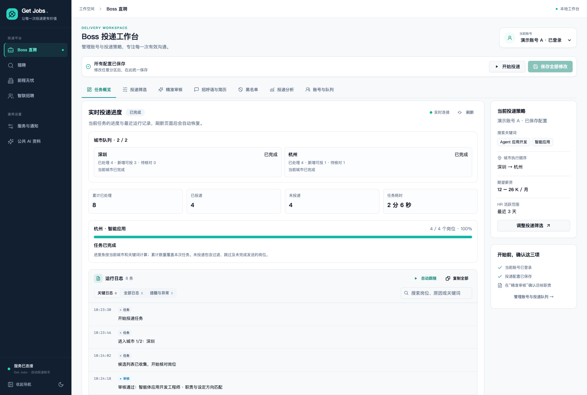
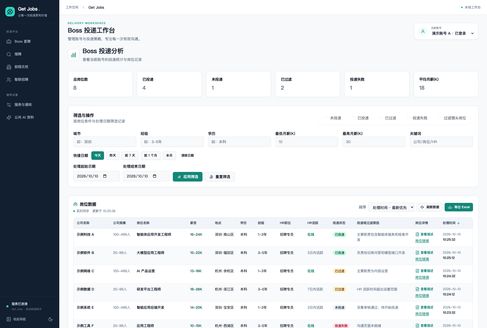

# Get Jobs · Boss 多账号工作台

## 项目介绍

本项目基于 [loks666/get_jobs](https://github.com/loks666/get_jobs) 二次开发，帮助求职者在本机管理 Boss 直聘的岗位筛选、投递和结果记录。可以先试审岗位，查看哪些职责符合自己的方向，再决定是否开始正式投递。

本版本的增强集中在 Boss 直聘。猎聘、前程无忧和智联招聘沿用上游流程。

## 功能特性

| 功能 | 用途 |
| --- | --- |
| 多账号与多城市 | 各 Boss 账号独立登录和配置。可一键同步账号配置，按顺序运行账号队列，并在一个账号内按设定顺序处理多个城市。 |
| 按职责精投 | 先核对薪资、经验和 HR 活跃等条件，再按职位描述（JD）审核职责。方向可手动填写，也可从简历经历中生成建议。 |
| 试审与费用控制 | 用示例、历史或新采集的岗位试审。岗位职责审核可复用缓存，并设置每次任务的 Token 预算。 |
| 投递进度与记录 | 工作台显示当前账号、城市和处理结果。达到平台当天沟通上限时结束当前账号，队列可继续下一个账号。 |
| 岗位分析与导出 | 按处理日期和岗位条件筛选，按处理时间或月薪排序。支持查看已保存的岗位描述和公司简介，并按当前筛选和排序导出 Excel 或 CSV。 |

## 界面截图与演示

以下截图来自使用模拟账号和模拟岗位的管理页。

**投递工作台**展示账号切换、城市进度、筛选配置和运行日志。



**投递分析**展示日期筛选、岗位状态、处理时间和 CSV 导出入口。



## 环境要求

| 依赖 | 要求 |
| --- | --- |
| 运行环境 | Windows、macOS 或 Linux 桌面环境，安装 Chrome 桌面版，用于扫码登录和查看招聘页面。 |
| Java | JDK 21，`JAVA_HOME` 指向 JDK 安装目录。 |
| 前端 | Node.js 24（含 npm）和 pnpm 11。 |
| 数据库初始化 | Python 3.11 或更新版本，用公开表结构生成本地 SQLite 数据库。 |
| 源码 | Git。项目自带 Gradle Wrapper。 |

## 安装部署

在 GitHub 本仓库的 **Code** 菜单复制地址，用 Git 克隆仓库并进入包含 `gradlew` 的目录。首次安装项目依赖前准备 pnpm。

```bash
npm install --global pnpm@11
```

首次启动需要初始化数据库。已有 `db/getjobs.db` 时从安装前端依赖那一步开始。

### macOS / Linux

```bash
python3 scripts/init_database.py
pnpm --dir front install --frozen-lockfile
sh ./gradlew bootRun
```

### Windows PowerShell

```powershell
py -3 scripts/init_database.py
pnpm --dir front install --frozen-lockfile
.\gradlew.bat bootRun
```

Gradle 会准备浏览器驱动、构建管理页并启动服务。首次构建需要联网下载依赖。启动成功后打开 [本地管理页](http://localhost:9527)。常规使用由一个进程提供管理页和 API。停止程序可在启动终端按 `Ctrl+C`。

## 配置说明

### Boss 账号和 AI

| 配置项 | 设置位置 |
| --- | --- |
| 搜索关键词、城市、薪资与 HR 活跃 | 当前 Boss 账号的「投递筛选」。 |
| 职位方向、目标职责与审核预算 | 当前 Boss 账号的「精准审核」。页面提供可替换的通用目标示例。 |
| 首次沟通文案、个人经历与图片简历 | 当前 Boss 账号的「招呼语与简历」。 |
| AI 招呼语开关 | 当前 Boss 账号的「精准审核 → 通过审核后，使用 AI 生成招呼语」。 |
| AI 服务地址、API Key 和模型 | 「服务与通知」。需要试审、简历方向分析或 AI 招呼语时填写，服务须提供兼容的 API。 |

开启「正式投递启用精准审核」后，候选岗位按当前账号的目标职责审核。使用普通投递与固定招呼语时，可关闭精准审核和 AI 招呼语两项开关。审核预算覆盖岗位职责审核，简历分析和招呼语各自消耗模型用量。

「公共 AI 资料」里的介绍和提示词用于默认 Boss 账号首次初始化。各账号的个人资料随工作台的「保存全部修改」保存。

### 本地数据库与个人资料

| 本地位置 | 保存内容 |
| --- | --- |
| `db/getjobs.db` | 账号配置、服务凭据、岗位历史、审核结果与缓存 |
| `browser-accounts/`、`browser-data/`、`cookies/` | 浏览器资料和登录状态 |
| `data/`、`target/` | 上传的简历图片、运行日志和构建产物 |
| `config/application-local.yaml`、`config/page-config.local.json`、`.env` | 本机配置与可选的初始化资料 |

这些路径已加入 Git 忽略规则。请将数据库、密钥、简历、Cookie、运行截图与日志留在本机。日常通过管理页保存设置即可。

需要给空白数据库预置页面配置时，可以把 [通用默认配置](src/main/resources/defaults/page-config.json) 复制为 `config/page-config.local.json`，再在 `config/application-local.yaml` 指定该文件。

```yaml
getjobs:
  defaults-file: ./config/page-config.local.json
```

## 使用教程

1. **登录账号。** 在「账号与队列」选择或新增账号，点击「打开该账号浏览器登录」。扫码后点击「确认并保存登录」。多个账号分别完成登录。
2. **填写投递条件。** 在「投递筛选」填写关键词和城市，再设置薪资、学历、经验与 HR 活跃。多城市按你的顺序执行，可在此处设定候选减少时的切换阈值。
3. **确定方向和招呼语。** 在「精准审核」填写目标岗位主要职责，也可上传简历生成方向建议并检查后采用。在「招呼语与简历」填写首次沟通文案，然后点「保存全部修改」。
4. **先试看筛选结果。** 打开「精准审核 → 试审与记录」，可用「试审 8 个示例（不投递）」验证方向。要核对真实候选岗位，先登录并保存设置，再点「采集并审核（不投递）」。
5. **启动投递。** 单账号点击「开始投递」。多账号在「账号与队列」排好顺序，再点击「启动账号队列」。
6. **查看和导出结果。** 在「任务概览」看实时进度与日志。到「投递分析」按日期筛选并查看处理结果。用「导出 Excel」获得带表头筛选的岗位表，从「查看详情」跳转到完整职位描述。CSV 可用于数据导入。

## 常见问题

**管理页打不开怎么办？** 从项目根目录启动，等终端显示服务启动完成后访问 `http://localhost:9527`。如果提示端口占用，先在原启动终端停止已运行的 Get Jobs 实例。

**昨天的记录在哪里？** 「投递分析」默认选中「今天」，按处理时间最新优先。点「昨天」查看昨日记录，或点「清除日期」后查询更早的记录。

**为什么填写了个人介绍，首次沟通仍然是固定文案？** AI 招呼语关闭时，程序使用当前账号的「自定义打招呼语」。要生成文案，请在该账号的「精准审核」勾选「通过审核后，使用 AI 生成招呼语」并保存。

**试审或简历分析调用失败怎么办？** 在「服务与通知」确认 API 地址、密钥和模型，然后再试。模型用量和计费以所选服务为准。

**更新源码后页面还是旧版怎么办？** macOS / Linux 用 `sh ./gradlew buildFrontend -PrebuildFrontend` 重新构建管理页，Windows PowerShell 用 `.\gradlew.bat buildFrontend -PrebuildFrontend`。之后刷新管理页。

<details>
<summary>开发测试与提交检查</summary>

```bash
pnpm --dir front test:progress
python3 -m unittest discover -s scripts -p "test_*.py"
sh ./gradlew test
python3 scripts/check_publication.py
```

Windows 下用 `py -3` 运行 Python 命令，用 `.\gradlew.bat test` 运行后端测试。用 `git config core.hooksPath .githooks` 可启用仓库的 Git 检查。

</details>

## 更新日志

### 2026-11-19

- 新增带固定表头、状态颜色和独立岗位详情的 Excel 导出。
- 新增账号间一键同步全部配置，完善多账号工作台。
- 岗位历史支持处理日期快捷筛选、时间和薪资排序、实时更新与 CSV 导出。
- 改善职位描述排版，独立显示公司简介。
- 适配已沟通会话中的「沟通新职位」弹窗，并按当前账号的重复沟通配置处理。
- 将 AI 招呼语开关统一放在各账号的「精准审核」中。

## 许可证

感谢 [loks666/get_jobs](https://github.com/loks666/get_jobs) 的作者和贡献者。二次开发版沿用上游的 **PolyForm Noncommercial License 1.0.0** 与版权声明。非商业使用、修改和分发的条款见 [LICENSE](LICENSE)。
